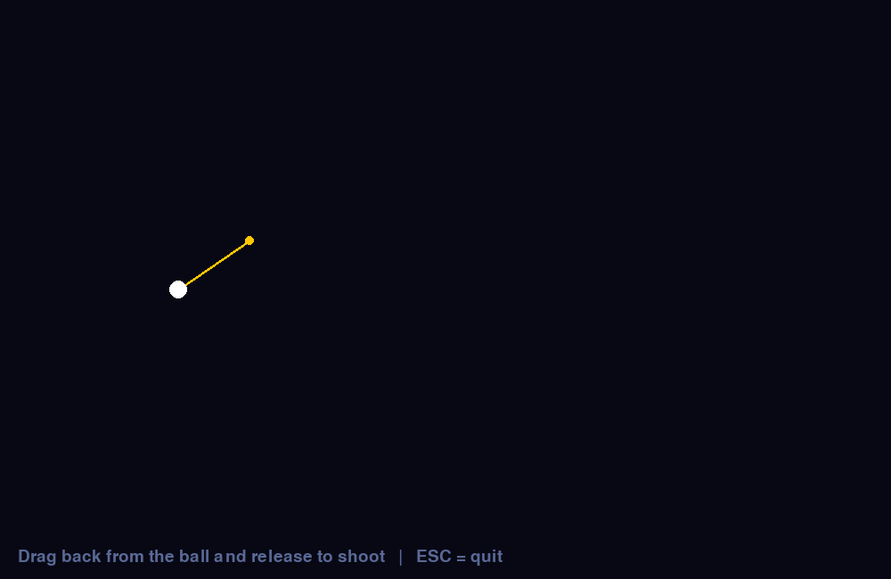

# Gravitas

**Name:** Md. Tareq Imroj
**Student ID:** 11230321233

> Work in progress. This README is updated every week as new features are added.

## About the Game

Gravitas is a 2D space mini-golf game. The goal is to shoot the ball into a hole in as few shots as possible, while planets and black holes bend its path with gravity.

## How to Play

| Input | Action |
|---|---|
| Mouse drag (pull back from the ball) + release | Aim and shoot, like a slingshot |
| `Esc` or close the window | Quit |

*(More controls will be added in later weeks.)*

## Features (done so far)

- Graphical window (Pygame, 1000 x 650)
- Ball controlled with the mouse (drag-to-shoot)
- Aiming arrow that shows the shot direction
- Shot power limited by the maximum drag distance
- Friction: the ball slows down and stops
- Bouncing off the screen edges (moving object + simple collision)
- Game loop running at 60 FPS
- Short on-screen hint for the controls

## Weekly Progress

| Week | Planned work | Status |
|---|---|---|
| 1 | Window, ball, drag-to-shoot input and friction | Done |
| 2 | Planets, gravity physics, hole and shot counter | Planned |
| 3 | Trajectory preview, ball trail, glow and starfield | Planned |
| 4 | Spacetime grid that bends around planets | Planned |
| 5 | Black hole, moving and repulsor planets, levels, collectible stars, undo and gravity flip | Planned |
| 6 | Menus, HUD, scoring, lives, game over, high score, pause, sound, final testing | Planned |

## Screenshots

### Week 1: aiming a shot


## Computer Graphics Concepts Used (so far)

- Game loop (event, update, draw)
- 2D vectors (position, velocity, pull direction)
- Screen coordinate system (origin at top-left, y increases downward)
- Friction as repeated multiplication of the velocity

## How to Run

Requires Python 3.10 or newer.

```
pip install -r requirements.txt
python main.py
```
